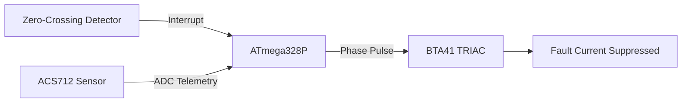

# COMMING SOON

> **Status:** Article in the works / draft in progress.

# Markdown Capabilities Demonstration

This document showcases the various formatting options, elements, and syntaxes you can use within a Markdown (`.md`) file. It covers both standard Markdown and common extensions like GitHub Flavored Markdown (GFM).

---

## 1. Headers

You can create headers using the `#` symbol. The number of hashes determines the header level (1-6).

# Header 1
## Header 2
### Header 3
#### Header 4
##### Header 5
###### Header 6

Alternatively, for H1 and H2, you can use underlines:

Header 1 Alternate
==================

Header 2 Alternate
------------------

---

## 2. Text Emphasis

You can emphasize text using italics, bold, or strikethrough.

* **Italics:** Use single asterisks or underscores. *This text is italicized* and _so is this_.
* **Bold:** Use double asterisks or underscores. **This text is bold** and __so is this__.
* **Bold and Italic:** Combine them. ***This text is bold and italicized***.
* **Strikethrough:** Use double tildes. ~~This text is crossed out.~~

---

## 3. Lists

Markdown supports ordered (numbered) and unordered (bulleted) lists, as well as nested lists.

### Unordered List
You can use `*`, `-`, or `+` for unordered lists.

* Item 1
* Item 2
  * Nested Item 2a
  * Nested Item 2b
    * Deeply nested item
* Item 3

### Ordered List
Use numbers followed by periods.

1. First item
2. Second item
   1. Nested ordered item
   2. Another nested item
3. Third item

### Task Lists (Checkboxes)
- [x] Completed task
- [ ] Incomplete task
- [ ] Another pending task

---

## 4. Links

You can create inline links or reference links.

* **Inline Link:** [Google Search](https://www.google.com)
* **Link with Title:** [Hover over me](https://www.google.com "This is a tooltip title!")
* **Reference Link:** Here is a link to [Wikipedia][wiki].
* **Autolink:** Direct URLs turn into links: https://example.com or <user@example.com>

[wiki]: https://www.wikipedia.org

---

## 5. Images

Images use a syntax similar to links, prefixed with an exclamation mark `!`.


---

## 6. Blockquotes

You can quote text using the `>` symbol.

> This is a blockquote.
> It can span multiple lines.
>
> > It can also be nested.
> 
> You can even include other markdown elements inside, like **bold text** or lists:
> - Quote list item 1
> - Quote list item 2

---

## 7. Code

You can format code inline or as block elements.

### Inline Code
Use single backticks for inline code: To print a message in Python, use `print("Hello World")`.

### Code Blocks
Use triple backticks (`` ` ``) or indent by 4 spaces for code blocks. You can specify the language for syntax highlighting.

```python
# A simple Python function
def greet(name):
    return f"Hello, {name}!"
    
print(greet("Markdown"))
```

```javascript
// A simple JavaScript function
function greet(name) {
    console.log(`Hello, ${name}!`);
}
```

---

## 8. Tables

Tables are created using pipes `|` and hyphens `-`. You can align text using colons `:`.

| Left-Aligned  | Center Aligned  | Right Aligned |
| :---         |     :---:      |          ---: |
| Row 1, Col 1  | Row 1, Col 2    | Row 1, Col 3  |
| Row 2, Col 1  | Row 2, Col 2    | Row 2, Col 3  |
| Row 3, Col 1  | Row 3, Col 2    | Row 3, Col 3  |

---

## 9. Horizontal Rules

Create a horizontal line using three or more hyphens, asterisks, or underscores.

---
***
___

---

## 10. Footnotes

Some markdown parsers support footnotes.

Here is a sentence that requires a footnote.[^1] Here is another one.[^2]

[^1]: This is the text for the first footnote.
[^2]: This is the text for the second footnote. It can also contain multiple lines or code.

---

## 11. Mathematics and Equations

If supported by the rendering engine (like MathJax or KaTeX), you can use LaTeX syntax for math.

**Inline math:** The equation for a line is $y = mx + c$.

**Block math:** The quadratic formula is:

$$x = \frac{-b \pm \sqrt{b^2 - 4ac}}{2a}$$

---

## 12. Escaping Characters

If you want to use a literal Markdown character, escape it with a backslash `\`.

\*This text is surrounded by literal asterisks, not italicized.\*
\# This is not a header.

---

## 13. HTML Integration

You can fall back to raw HTML if you need formatting not supported by standard Markdown.

<details>
  <summary>Click here to expand!</summary>
  <p>This is hidden content rendered using HTML details and summary tags.</p>
</details>

<p align="center" style="color: blue;">This text is centered and blue using HTML inline styles.</p>

## 14. Mermaid Chart


## 15. Interactive Data chart
```chart
{
  "type": "line",
  "title": "Fault Current Limitation vs Traditional Breaker",
  "labels": ["0ms", "5ms", "10ms", "15ms", "20ms", "25ms"],
  "datasets": [
    { "label": "FCLCB Active Mitigated (A)", "data": [0, 4.2, 5.1, 4.8, 1.2, 0] },
    { "label": "Uncontrolled Fault Surge (A)", "data": [0, 18.5, 42.1, 38.0, 22.4, 0] }
  ]
}
```
